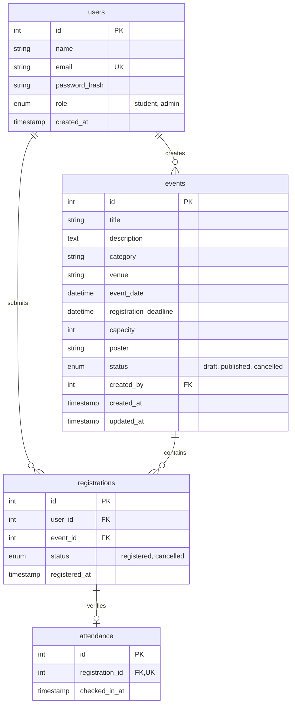

# CampusConnect — Full-Stack College Event Management Platform

[](https://www.php.net/)
[](https://www.mysql.com/)
[](https://getbootstrap.com/)
[](documents/technical/architecture.md)
[](LICENSE)

A full-stack, database-driven college event management web application developed using **Core PHP**, **MySQL**, **PDO**, **Bootstrap 5**, and a custom **editorial collegiate design system**.

Designed as a student-developed academic MVP for **Supreme Knowledge Foundation Group of Institutions (SKFGI)**, Mankundu, Hooghly (affiliated with **MAKAUT, West Bengal**). CampusConnect replaces chaotic WhatsApp forwards and manual spreadsheets with verified venue capacities, real-time seat reservation locking, door attendance tracking, and comprehensive administrative reporting.

---

## 📌 Table of Contents

- [Key Highlights](#-key-highlights)
- [System Architecture & Technology Stack](#-system-architecture--technology-stack)
- [Core Features](#-core-features)
  - [1. Public-First Event Discovery](#1-public-first-event-discovery)
  - [2. Authenticated Student Portal](#2-authenticated-student-portal)
  - [3. Comprehensive Admin Center](#3-comprehensive-admin-center)
- [Security & Concurrency Engineering](#-security--concurrency-engineering)
- [Database Schema & Entity Relationships](#-database-schema--entity-relationships)
- [Project Directory Layout](#-project-directory-layout)
- [Installation & Local Setup](#-installation--local-setup)
- [Demo Credentials](#-demo-credentials)
- [Automated Verification & Testing](#-automated-verification--testing)
- [Author & Academic Notice](#-author--academic-notice)

---

## 🚀 Key Highlights

- **Public-First Browsing**: Open access for visitors to explore upcoming events, filter categories, search venues, and check live seat availability without forced account creation.
- **Race-Condition-Safe Seat Locking**: Concurrency control using `SELECT ... FOR UPDATE` inside PDO transactions, guaranteeing rooms cannot be overbooked.
- **Live Database Metrics**: No hardcoded statistics. Every percentage, available-seat counter, and report card is dynamically aggregated from MySQL.
- **Safe Event Deletion & Soft Cancellation**: Events with zero registrations can be permanently removed; events with confirmed student bookings are automatically transitioned to `cancelled` to preserve historical integrity.
- **Door Attendance Tracking**: Real-time event check-in toggle (`✓ Present` / `Undo`) for faculty coordinators at the venue entrance.
- **Attendee Roster CSV Export**: Instant UTF-8 formatted Excel/CSV export for departmental rolls and event coordinators.
- **Modern Collegiate UI**: Custom visual hierarchy using Deep Violet (`#6842e8`), Eventbrite-style date badge blocks, accessible color contrast, and zero generic marketing fluff.

---

## 🛠 System Architecture & Technology Stack

```
   ┌─────────────────────────────────────────────────────────┐
   │                    Client Browser                       │
   │  (Responsive Bootstrap 5.3.3 + Custom CSS3 Design System) │
   └────────────────────────────┬────────────────────────────┘
                                │ HTTP / HTTPS
                                ▼
   ┌─────────────────────────────────────────────────────────┐
   │                  Apache Web Server                      │
   │               (URL / Script Routing)                    │
   └────────────────────────────┬────────────────────────────┘
                                │
                                ▼
   ┌─────────────────────────────────────────────────────────┐
   │                 PHP 8.2 Execution Core                  │
   │  ┌───────────────────────┐   ┌───────────────────────┐  │
   │  │ includes/auth.php     │   │ config/database.php   │  │
   │  │ - Session Regeneration│   │ - PDO Connection Pool │  │
   │  │ - CSRF Verification   │   │ - ErrorMode Exception │  │
   │  │ - Role Authorization  │   │ - Emulated Prepares: 0│  │
   │  └───────────────────────┘   └───────────────────────┘  │
   └────────────────────────────┬────────────────────────────┘
                                │ Native PDO Driver (Prepared Queries)
                                ▼
   ┌─────────────────────────────────────────────────────────┐
   │              MySQL 8.x / MariaDB Database               │
   │  - users        (BCrypt Passwords & Roles)              │
   │  - events       (Capacities, Schedules, Deadlines)       │
   │  - registrations(Unique user_id + event_id Constraint)  │
   │  - attendance   (Checked-in timestamps & Foreign Keys)  │
   └─────────────────────────────────────────────────────────┘
```

| Layer | Technologies & Tools |
|---|---|
| **Backend Runtime** | **Core PHP 8.2+** (Native procedural architecture with reusable auth & database modules) |
| **Database Engine** | **MySQL 8.0+ / MariaDB** (InnoDB engine, foreign key constraints, ACID transaction support) |
| **Database Access** | **PHP Data Objects (PDO)** with emulated prepared statements disabled (`ATTR_EMULATE_PREPARES => false`) |
| **Frontend Framework** | **Bootstrap 5.3.3** (Responsive grid, accessible form inputs, flex utilities) |
| **Custom Styling** | **Vanilla CSS3** (`assets/css/style.css` with modular CSS variables, micro-interactions) |
| **Typography** | **Google Fonts** ([Outfit](https://fonts.google.com/specimen/Outfit) for headings, [Inter](https://fonts.google.com/specimen/Inter) for clean interface text) |
| **Server Environment** | **Apache** (XAMPP on Windows, Linux LAMP stack, or standard cPanel hosting) |

---

## 🌟 Core Features

### 1. Public-First Event Discovery
- **Homepage (`index.php`)**: Editorial hero section, dynamic upcoming events spotlight with live seat meters, academic project disclaimer, category exploration cards, and realistic student FAQ.
- **Event Directory (`events.php`)**: Multi-term search across titles, descriptions, and venues. Real-time category filtering (dynamically queried from MySQL) and multiple sorting modes (date ascending/descending, title, capacity).
- **Event Detail Page (`event-details.php`)**: Complete overview including schedule, venue directions, registration deadline warnings, capacity meter, and state-aware call-to-actions based on current authentication status.

### 2. Authenticated Student Portal
- **Student Dashboard (`dashboard.php`)**: Personalized greeting, live summary metrics (Upcoming Confirmed Seats, Active Registrations, Historical Records), and interactive schedule cards with Eventbrite-style date blocks.
- **Registration Management (`my-registrations.php`)**: Clean separation between **Active & Upcoming** events and **Past & Cancelled Activity**.
- **One-Click Cancellation (`cancel-registration.php`)**: Students can release reserved seats before event deadlines, immediately restoring capacity for peers.
- **Registration Confirmation (`register-event.php`)**: Instant transactional booking with automatic deadline and seat quota verification.

### 3. Comprehensive Admin Center
- **Admin Dashboard (`admin/index.php`)**: Live system statistics (Total Events, Published Events, Verified Student Profiles, Active Bookings) and quick administrative shortcuts.
- **Event Catalog Management (`admin/events.php`)**: Full event table with attendee ratios, percentage occupancy, and publication status badges (`Published`, `Draft`, `Cancelled`).
- **Create & Edit Events (`admin/event-form.php`, `admin/edit-event.php`)**: Strict validation preventing capacity reduction below current active registrations, deadline enforcement, and venue management.
- **Safe Event Deletion (`admin/delete-event.php`)**: Protects data integrity by checking registration counts before deletion.
- **Attendee Roster & Door Check-in (`admin/attendees.php`, `admin/check-in.php`)**: Filter attendees by event, view registration timestamps, mark door attendance (`✓ Present` / `Undo`), and view live check-in summaries.
- **CSV Data Export (`admin/export-attendees.php`)**: Generates clean `.csv` attendee spreadsheets with UTF-8 BOM encoding for Excel.
- **Analytics & Reports (`admin/reports.php`)**: System-wide performance overview, total seats provisioned, total registered seats, and capacity utilization analytics.

---

## 🔒 Security & Concurrency Engineering

1. **SQL Injection Immunity**: 100% of database interactions utilize PDO prepared statements with parameterized inputs. Direct variable concatenation into SQL strings is strictly prohibited.
2. **Race-Condition Defense (`FOR UPDATE`)**: During event registration, the target event row is locked at the database transaction layer using `SELECT capacity, registration_deadline FROM events WHERE id = :id FOR UPDATE`. This eliminates race conditions when multiple students claim the final remaining seat simultaneously.
3. **Password Security**: Passwords are encrypted using native BCrypt via `password_hash($password, PASSWORD_DEFAULT)` and verified using `password_verify()`. Hashes are never logged or exposed in client responses.
4. **Session Fixation Defense**: Successful login immediately invokes `session_regenerate_id(true)` to invalidate existing session tokens and issue fresh session cookies.
5. **CSRF Protection**: All state-changing requests (booking, cancelling, editing, publishing, deleting, check-in, logout) require an HTTP POST method validated against an anti-CSRF token using timing-attack-safe `hash_equals()`.
6. **Insecure Direct Object Reference (IDOR) Mitigation**: Cancellations bind both `registration_id` and the authenticated `$_SESSION['user']['id']` in the `UPDATE` query, preventing users from tampering with registrations owned by others.
7. **Universal XSS Sanitization**: Dynamic user input rendered in HTML is sanitized using `htmlspecialchars($str, ENT_QUOTES, 'UTF-8')`.

---

## 🗄 Database Schema & Entity Relationships



The database enforces referential integrity using `FOREIGN KEY ... ON DELETE RESTRICT` constraints, ensuring orphaned records cannot be created.

---

## 📂 Project Directory Layout

```text
CampusConnect/
├── admin/                         # Administrator management portal
│   ├── index.php                  # Admin dashboard & live metrics overview
│   ├── events.php                 # Event catalog management
│   ├── event-form.php             # Event creation interface
│   ├── edit-event.php             # Event editor & capacity adjustment
│   ├── delete-event.php           # Safe deletion / soft cancellation handler
│   ├── attendees.php              # Attendee roster & door check-in UI
│   ├── check-in.php               # POST handler for door check-in toggle
│   ├── export-attendees.php       # UTF-8 CSV roster generator
│   └── reports.php                # Platform occupancy & capacity analytics
├── assets/                        # Static client-side assets
│   └── css/
│       └── style.css              # Custom editorial design system & variables
├── config/                        # Core configuration
│   └── database.php               # PDO database connection with error handling
├── documents/                     # Project technical & product documentation
│   ├── product/                   # PRD and roadmap phases
│   ├── technical/                 # System architecture & design system
│   └── guidelines/                # Engineering rules & developer memory log
├── includes/                      # Shared reusable components
│   ├── auth.php                   # Authentication routines, CSRF & session guards
│   ├── header.php                 # Global responsive navigation header
│   └── footer.php                 # Global footer & institutional context
├── cancel-registration.php        # POST handler: student registration cancellation
├── dashboard.php                  # Authenticated student dashboard
├── database.sql                   # MySQL schema DDL definition script
├── event-details.php              # Event overview, live seats & booking UI
├── events.php                     # Searchable public event directory
├── index.php                      # Public homepage & featured events spotlight
├── login.php                      # User sign-in with quick demo explorer
├── logout.php                     # Secure POST-only session termination
├── my-registrations.php           # Student registration history & schedule
├── register-event.php             # POST handler: transactional event booking
├── register.php                   # Student account registration
├── setup-admin.php                # CLI helper to promote existing account to admin
└── setup-demo.php                 # Idempotent collegiate seeder (6 SKFGI demo events)
```

---

## 💻 Installation & Local Setup

### Prerequisites
- **PHP 8.2 or higher** with `pdo_mysql`, `mbstring`, and `openssl` extensions enabled.
- **MySQL 8.0+ / MariaDB 10.4+**.
- **Apache Web Server** (e.g. via [XAMPP](https://www.apachefriends.org/), WampServer, or native package).

### Step 1: Clone or Copy the Repository
Place the project inside your web server's document root (for XAMPP on Windows: `C:\xampp\htdocs\CampusConnect`):
```bash
cd C:\xampp\htdocs
git clone https://github.com/ankitpal32/CampusConnect.git
```

### Step 2: Database Setup
1. Start **Apache** and **MySQL** in your XAMPP Control Panel.
2. Open **phpMyAdmin** (`http://localhost/phpmyadmin`) or MySQL CLI.
3. Import the database schema from `database.sql`:
```bash
mysql -u root -p < database.sql
```
*(Or create a database named `campusconnect` and import `database.sql` through phpMyAdmin).*

### Step 3: Verify Database Connection Configuration
Inspect [`config/database.php`](config/database.php) to ensure your local credentials match:
```php
define('DB_HOST', 'localhost');
define('DB_NAME', 'campusconnect');
define('DB_USER', 'root');
define('DB_PASS', ''); // Leave empty for default XAMPP setup
define('DB_CHARSET', 'utf8mb4');
```

### Step 4: Seed Demo Data & Demo Accounts
Run the automated seeder script via CLI or browser to initialize the dedicated demo accounts, 6 SKFGI demo events, and sample registrations:
```bash
php setup-demo.php
```
*Alternatively, visit `http://localhost/campusconnect/setup-demo.php` in your browser.*

### Step 5: Launch the Application
Open your browser and navigate to:
```text
http://localhost/campusconnect/
```

---

## 🔑 Demo Credentials

CampusConnect includes pre-configured, clearly labeled demonstration accounts for examiners, evaluators, and portfolio reviewers:

| Role | Email Address | Password | Capabilities |
|---|---|---|---|
| **Demo Student** | `demo.student@campusconnect.edu` | `StudentDemo@2026` | Browse published events, reserve seats, view registered schedule, cancel bookings |
| **Demo Admin** | `demo.admin@campusconnect.edu` | `AdminDemo@2026` | Create & edit events, manage capacities, door attendance check-in, CSV export, analytics |

> **Convenience Feature**: The login page (`login.php`) includes an interactive **"Try the Demo"** card with one-click credential auto-fill for frictionless testing in local environments.

---

## 🧪 Automated Verification & Testing

The project includes built-in verification scripts in the development environment ensuring regression safety:
- **Syntax Integrity**: `php -l` executed with 0 syntax errors across all 22 PHP scripts.
- **Automated HTTP Flow Tests**: Verified 200 HTTP response codes across public browsing, search filters, student booking/cancellation cycles, and administrative rosters.
- **Idempotency Assurance**: Repeated runs of `setup-demo.php` refresh event schedules without generating duplicate records.

---

## 🎓 Author & Academic Notice

- **Developer**: **Ankit Pal**
- **Institution**: **Supreme Knowledge Foundation Group of Institutions (SKFGI)**
- **Location**: 1 Khan Road, Mankundu, Chandannagar, Hooghly, West Bengal
- **Affiliation**: **Maulana Abul Kalam Azad University of Technology (MAKAUT), West Bengal**
- **Project Notice**: *CampusConnect is developed as an academic software engineering project to demonstrate practical Core PHP, MySQL, PDO transactions, seat reservation locking, and door attendance tracking. It does not serve as an official institutional announcement platform for SKFGI.*

---

## 📄 License

This project is open-source software licensed under the [MIT License](LICENSE).
