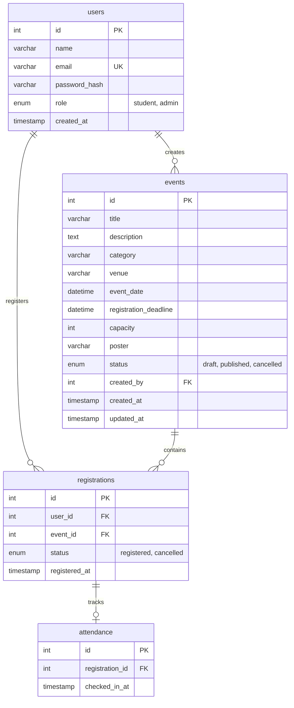

# System Architecture Specification — CampusConnect

This document describes the architectural design, database model, data flows, and security model of CampusConnect.

---

## 1. High-Level Technology Stack

CampusConnect is intentionally built as a lightweight, performant, native PHP web application without heavy framework overhead:

- **Runtime / Language**: PHP 8.2 (Procedural core PHP with dedicated helper functions and clean separation of concerns).
- **Database Engine**: MySQL 8.x / MariaDB via PHP Data Objects (PDO) with InnoDB storage engine for foreign keys and ACID transactions.
- **Frontend / Styling**: Vanilla CSS design system (`assets/css/style.css`) layered over Bootstrap 5.3.3 (grid and layout utilities), utilizing Google Fonts (`Outfit` & `Inter`).
- **Client Scripting**: Vanilla JavaScript for accessible UI controls (such as password visibility toggles and mobile navigation toggles).
- **Local Environment**: XAMPP on Windows (`c:\xampp\htdocs\CampusConnect`), Apache web server, MySQL on port 3306.

---

## 2. Directory Layout & Routing Model

The application uses straightforward file-based routing. URLs map directly to PHP scripts on disk, making the codebase simple to understand, navigate, and maintain:

```text
c:\xampp\htdocs\CampusConnect\
├── admin\                     # Administrator Portal
│   ├── index.php              # Admin dashboard & platform statistics overview
│   ├── events.php             # Event management catalog table
│   ├── event-form.php         # Event creation form
│   ├── edit-event.php         # Event editing & capacity management
│   ├── attendees.php          # Event attendee rosters & student filters
│   └── reports.php            # Platform analytics & occupancy calculations
├── assets\                    # Static Assets
│   └── css\
│       └── style.css          # Core design system stylesheet & CSS variables
├── config\                    # Environment Configuration
│   └── database.php           # PDO connection instance with error handling
├── documents\                 # Project Documentation
│   ├── product\               # PRD and roadmap phases
│   ├── technical\             # Architecture and design system
│   └── guidelines\            # Coding rules and project memory
├── includes\                  # Reusable Server Components
│   ├── auth.php               # Auth functions, session management, CSRF helpers
│   ├── header.php             # Shared HTML header, navbar, role badges
│   └── footer.php             # Shared HTML footer, copyright, navigation
├── uploads\                   # Stored Uploads (e.g., event poster assets)
├── index.php                  # Public homepage with featured upcoming events
├── events.php                 # Searchable & filterable public event directory
├── event-details.php          # Single event page, capacity tracker, registration UI
├── login.php                  # User sign-in with role redirection
├── logout.php                 # POST-only CSRF-verified session termination
├── register.php               # Student account registration
├── dashboard.php              # Authenticated student portal
├── my-registrations.php       # Student registrations & cancellation actions
├── register-event.php         # POST handler: transactional event booking
├── cancel-registration.php    # POST handler: student registration cancellation
└── database.sql               # Complete SQL schema & table definitions
```

---

## 3. Database Schema & Data Models

The database (`campusconnect`) consists of 4 relational tables in InnoDB with foreign key constraints:



### Table Definitions & Constraints

1. **`users`**:
   - `id`: INT UNSIGNED AUTO_INCREMENT PRIMARY KEY.
   - `name`: VARCHAR(100) NOT NULL.
   - `email`: VARCHAR(150) NOT NULL UNIQUE.
   - `password_hash`: VARCHAR(255) NOT NULL.
   - `role`: ENUM('student', 'admin') NOT NULL DEFAULT 'student'.
   - `created_at`: TIMESTAMP DEFAULT CURRENT_TIMESTAMP.

2. **`events`**:
   - `id`: INT UNSIGNED AUTO_INCREMENT PRIMARY KEY.
   - `title`: VARCHAR(200) NOT NULL.
   - `description`: TEXT NOT NULL.
   - `category`: VARCHAR(80) NOT NULL.
   - `venue`: VARCHAR(200) NOT NULL.
   - `event_date`: DATETIME NOT NULL.
   - `registration_deadline`: DATETIME NOT NULL.
   - `capacity`: INT UNSIGNED NOT NULL.
   - `poster`: VARCHAR(255) DEFAULT NULL.
   - `status`: ENUM('draft', 'published', 'cancelled') NOT NULL DEFAULT 'draft'.
   - `created_by`: INT UNSIGNED NOT NULL (FOREIGN KEY references `users(id)` ON DELETE RESTRICT).
   - Index: `idx_events_date_status (status, event_date)` for fast upcoming event queries.

3. **`registrations`**:
   - `id`: INT UNSIGNED AUTO_INCREMENT PRIMARY KEY.
   - `user_id`: INT UNSIGNED NOT NULL (FOREIGN KEY references `users(id)` ON DELETE RESTRICT).
   - `event_id`: INT UNSIGNED NOT NULL (FOREIGN KEY references `events(id)` ON DELETE RESTRICT).
   - `status`: ENUM('registered', 'cancelled') NOT NULL DEFAULT 'registered'.
   - `registered_at`: TIMESTAMP DEFAULT CURRENT_TIMESTAMP.
   - Constraint: `UNIQUE KEY unique_user_event (user_id, event_id)` ensures a student only ever has one record per event.
   - Index: `idx_registration_event_status (event_id, status)` for fast capacity counts.

4. **`attendance`**:
   - `id`: INT UNSIGNED AUTO_INCREMENT PRIMARY KEY.
   - `registration_id`: INT UNSIGNED NOT NULL UNIQUE (FOREIGN KEY references `registrations(id)` ON DELETE RESTRICT).
   - `checked_in_at`: TIMESTAMP DEFAULT CURRENT_TIMESTAMP.

---

## 4. Concurrency & Transactional Capacity Control

To eliminate race conditions and guarantee that room capacities are never exceeded during registration rushes, CampusConnect uses database-level row locking:

### Registration Flow (`register-event.php`)
```text
[HTTP POST register-event.php]
  ├── 1. Verify CSRF Token (CSRF valid? If no, HTTP 403)
  ├── 2. Verify Session (Student role? If no, redirect)
  ├── 3. Begin PDO Transaction ($pdo->beginTransaction())
  │     ├── Lock Event Row: SELECT id, capacity, registration_deadline FROM events WHERE id = :id FOR UPDATE
  │     ├── Check Deadlines: (time() < deadline && time() < event_date)
  │     ├── Check Existing Registration: (Is student already registered?)
  │     ├── Count Active Seats: SELECT COUNT(*) FROM registrations WHERE event_id = :id AND status = 'registered'
  │     └── Verify: (registeredCount < capacity)
  │           ├── True: Insert new registration OR restore previously cancelled record
  │           └── False: Throw RuntimeException('Sorry, this event is full.')
  ├── 4. Commit Transaction ($pdo->commit())
  └── 5. Redirect: /campusconnect/my-registrations.php?registered=1
  [On Exception: $pdo->rollBack() -> redirect with flash error message]
```

### Capacity Reduction Protection (`admin/edit-event.php`)
When an administrator edits an event, the system locks the event with `FOR UPDATE` and queries `SELECT COUNT(*) FROM registrations WHERE event_id = :id AND status = 'registered'`. If the administrator submits a capacity lower than confirmed bookings (`$capacityNumber < $activeRegistrations`), the transaction rolls back and an error message is returned.

---

## 5. Authentication & Session Architecture

- **Session Handling**: Sessions are initialized using `session_status() !== PHP_SESSION_ACTIVE ? session_start() : null`.
- **Session Fixation Defense**: Immediately after credentials are verified via `password_verify()`, `session_regenerate_id(true)` is invoked to rotate the session identifier.
- **CSRF Token Lifecycle**:
  - `csrfToken()` generates a 32-byte cryptographic random token (`bin2hex(random_bytes(32))`) stored in `$_SESSION['csrf_token']`.
  - All state-changing requests (event booking, cancellation, event creation, event edit, logout) require this token as a hidden field.
  - Validation uses `hash_equals()` to prevent timing attacks.
- **Authorization Enforcement**:
  - `requireLogin()` redirects unauthenticated visitors to `/campusconnect/login.php`.
  - `requireAdmin()` checks `$_SESSION['user']['role'] === 'admin'` and exits with HTTP 403 if unauthorized. Key administrator pages also re-verify the account's role directly against the `users` table to handle role revocations immediately.

---

## 6. Defensive Coding Practices

1. **Prepared Statements**: All queries with user-supplied variables use PDO prepared statements with named parameters (`:id`, `:email`, `:category`, etc.). Emulated prepares are disabled (`PDO::ATTR_EMULATE_PREPARES => false`).
2. **Output Sanitization**: All content rendered to HTML passes through `htmlspecialchars((string)$val, ENT_QUOTES, 'UTF-8')`.
3. **HTTP Status Codes**: Clean semantic HTTP codes are returned for error states (`400 Bad Request`, `403 Forbidden`, `404 Not Found`, `405 Method Not Allowed`, `500 Internal Error`).
4. **Log Separation**: Unhandled database exceptions log detailed errors to server error logs via `error_log()` while displaying friendly, sanitized notices to the user.
